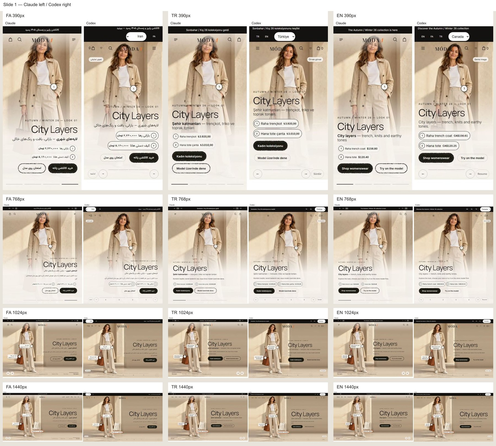
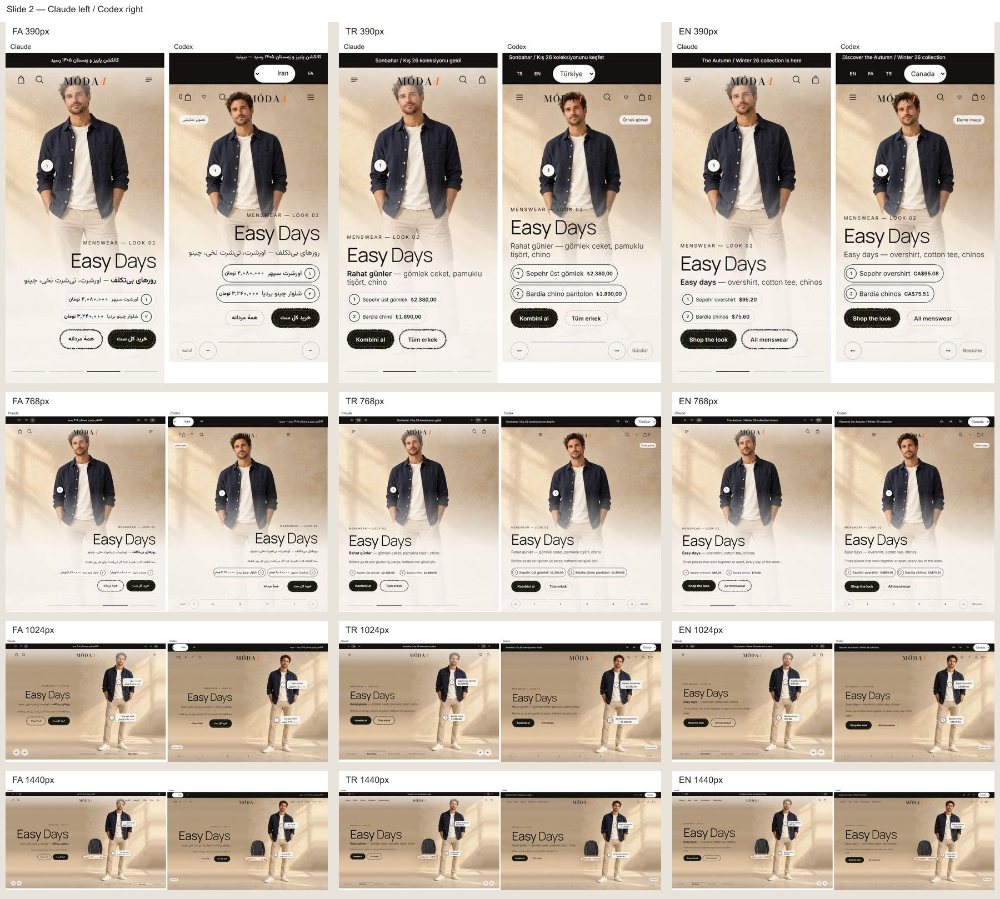
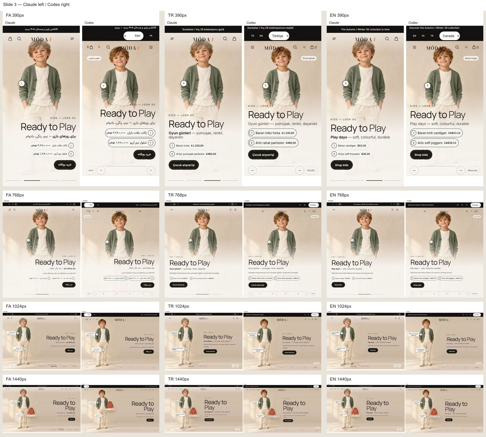
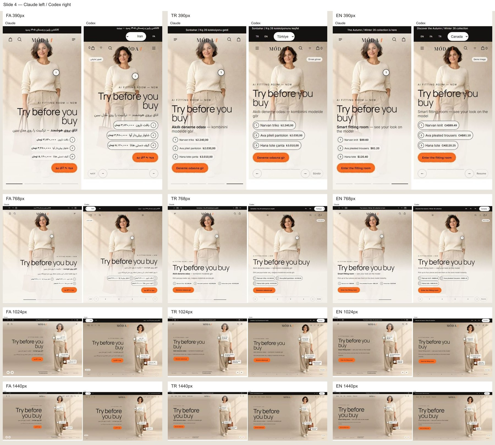

# شواهد تصویری M4-01

تمام جفت‌ها capture واقعی هستند: Claude سمت چپ، Codex سمت راست. [۴۸ جفت اصلی](image-manifest.json) در پوشه compare، برای FA/TR/EN، عرض‌های 390/768/1024/1440 و چهار اسلاید ثبت شده‌اند. جفت اصلی در اندازه طبیعی است؛ صفحه‌های زیر صرفاً نمای کلی کوچک‌شده‌اند. [اندازه‌گیری ۴۸ حالت](hero-measurements.json) و [قرارداد قبلی ۱۴۶/۱۴۶](legacy-fidelity-results.json) همراه‌اند.

## شواهد عیب و اصلاح

- [CTA موبایل پیش از اصلاح](before-mobile-cta-wrap.jpg): مقایسه مرجع با اولین اجرای Codex.
- [COMPOSITE قبل](before-legacy-composite-1440.png) و [بعد در دسکتاپ](after-legacy-composite-1440.png) / [موبایل](after-legacy-composite-390.png): قبل و بعد Codex، با Reduced Motion و پوشاک واقعی همان صحنه؛ این‌ها تصویر مرجع Claude نیستند.
- [هشدار واقعی پنل](admin-layout-warnings.png): پس از قبول حالت سالم، محدوده مدل عمداً خصوصی نامعتبر شده و H-01 در زبان‌ها/اندازه‌های لازم نمایش داده می‌شود.
- [علت رگال قبل از هر اصلاح داده](fitting-reasons-before.json) و [نتایج آزمون](verification.json).

نمونه و برنامه CSS viewport و density برابر دارند. crop بنر در موبایل برنامه جای ناوبری ثابت واقعی را رزرو می‌کند؛ فاصله سفید جفت برای هم‌ارتفاع‌کردن صفحه است. نوار بازار، کنترل‌های واقعی، حداقل لمس ۴۴ پیکسل، نشان تصویر نمایشی و قیمت زنده کاتالوگ، تفاوت‌های اعلام‌شده با نمونه‌اند. هیچ معیار قبلی حذف یا ضعیف نشده است. این شواهد، خودبازبینی/آزمون هستند؛ تأیید بصری نهایی با مهدی است.
